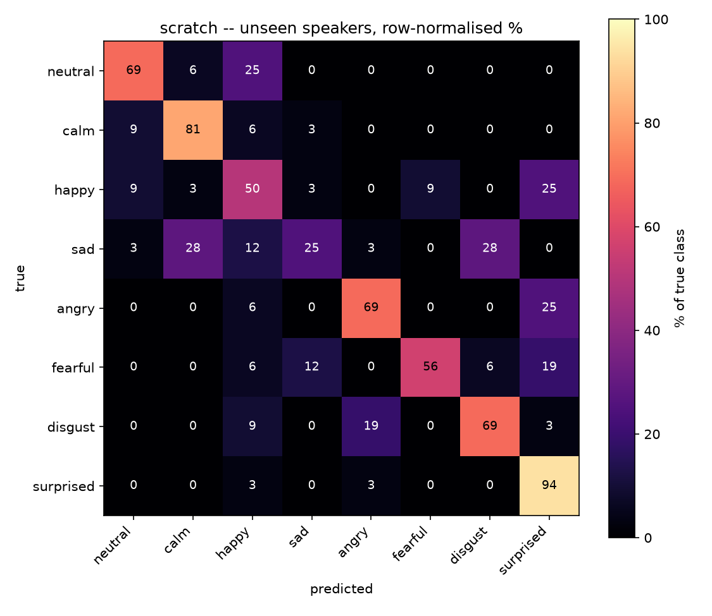

# Voice emotion recognition with CNNs

Record a sentence in the browser, watch the mel spectrogram build in real time,
and see what three convolutional networks hear in your voice.

- **Live app:** https://voice-emotion-1019364994073.europe-west9.run.app
- **Repository:** https://github.com/vizanca12/voice_emotion.git 

Corpus: [RAVDESS](https://zenodo.org/records/1188976) — 1440 clips, 24 actors,
8 emotions. Course assignment, *Apprentissage pour la robotique*, ENSTA Paris.

---

## Results

All scores are on four actors held out of training entirely.

| Model | Architecture | Parameters (trainable) | UAR | Accuracy |
|---|---|---|---|---|
| **`scratch`** | 4 conv blocks → GAP → linear | 1.17 M (all) | **64.1 %** | 63.7 % |
| `transfer_ft` | ResNet-18, `layer4` fine-tuned | 11.18 M (8.40 M) | 59.0 % | 59.6 % |
| `transfer` | ResNet-18, backbone frozen | 11.18 M (4.1 k) | 34.4 % | 36.7 % |

Chance is 12.5 %. The headline metric is **UAR** (unweighted average recall):
RAVDESS has 96 neutral clips against 192 of every other class, so accuracy
rewards a model that ignores the rare one.

Per-class recall, `scratch`:

| neutral | calm | happy | sad | angry | fearful | disgust | surprised |
|---|---|---|---|---|---|---|---|
| 68.8 % | 81.2 % | 50.0 % | **25.0 %** | 68.8 % | 56.2 % | 68.8 % | 93.8 % |



Errors follow **arousal, not valence**: sad → calm 28 %, sad → disgust 28 %,
happy → surprised 25 %, angry → surprised 25 %. The network reads how activated
a voice is far more reliably than whether the feeling is positive or negative.
Sadness is weakest because a quiet, slow, flat voice is acoustically close to a
calm one.

## Speaker-independent evaluation

A random clip-level split puts the same actor in train and test, and the network
then scores by recognising *the person* rather than the emotion. With only 24
speakers that leak is severe, so every actor is used in exactly one split:

| Split | Actors | Clips | Used for |
|---|---|---|---|
| train | 1–16 | 960 | fitting weights |
| validation | 17–20 | 240 | choosing the stopping epoch only |
| test | 21–24 | 240 | evaluated once, after training |

Actor ids alternate male/female, so each group is sex-balanced. Validation is a
*separate* speaker group from test — picking the best epoch on test would leak
it. `make_loaders()` asserts the three groups are disjoint, and a test asserts
that the guard fires.

**5-fold speaker-grouped cross-validation**, every actor held out exactly once:

| Fold | 1 | 2 | 3 | 4 | 5 | mean |
|---|---|---|---|---|---|---|
| UAR | 67.5 % | 73.8 % | 65.9 % | 58.1 % | 63.7 % | **65.8 % ± 5.1 %** |

The fixed split's 64.1 % sits inside one standard deviation, so it was not a
lucky choice of actors. The ±5.1 points come purely from *which* speakers are
held out — more than the margin most papers claim between methods on a single
split.

## What transfer learning did

The frozen ImageNet backbone reached 34.4 % UAR, roughly half the small network
trained from scratch despite ten times the parameters. Unfreezing `layer4` alone
recovered **+24.6 points**.

ImageNet features assume translation invariance in both axes. On a spectrogram
that holds for time but not for frequency, where a shift changes the pitch and
therefore the class. Early filters (edges) still transfer, which is why
fine-tuning one stage closes most of the gap; the late object-specific layers do
not. With 960 training clips, a 1.2 M network designed for the input beats an
11 M network designed for something else.

## Audio front-end

Both networks see the same 64 × 301 log-mel image. `src/features.py` is imported
by the training code *and* by the server, and a test pins the two paths
together — if they drifted, the deployed model would be fed a distribution it
never saw and nothing would raise.

| Step | Value |
|---|---|
| resample, downmix | 16 kHz mono |
| window | most energetic 3.0 s (zero-padded if shorter) |
| STFT | 400-sample frame (25 ms), 160-sample hop (10 ms) |
| mel filterbank | 64 bands, 20 Hz – 8 kHz, power → dB, 80 dB floor |
| normalisation | per-example mean/std, which makes the front end gain-invariant |
| augmentation | SpecAugment (2 freq × 8 bands, 2 time × 30 frames) + ±0.4 s shift |

Training: AdamW, OneCycle, class-weighted cross-entropy with 0.05 label
smoothing, batch 32, mixed precision, checkpoint on best validation UAR.
`scratch` trains in 80 s on an RTX 3060.

## The app

The browser runs two audio paths: an `AnalyserNode` draws the live scrolling
spectrogram while you speak, and a `MediaRecorder` captures the clip, which is
decoded and resampled to 16 kHz client-side. Resampling in the browser means the
server never decodes WebM/Opus, so the container needs no ffmpeg. The
spectrogram shown after analysis is the exact tensor the CNNs received.

| Endpoint | |
|---|---|
| `GET /` | recording page |
| `GET /api/meta` | classes, loaded models, their scores |
| `POST /api/predict` | raw float32 PCM body, `?sr=` |
| `POST /api/predict-file` | multipart wav/flac/ogg |
| `GET /health` | liveness + loaded checkpoints |

## Run it

```bash
python -m venv .venv && .venv/Scripts/activate     # Linux/macOS: source .venv/bin/activate
pip install torch==2.5.1 torchaudio==2.5.1 torchvision==0.20.1 \
    --index-url https://download.pytorch.org/whl/cu121   # drop --index-url for CPU
pip install -r requirements.txt

python scripts/get_data.py                 # RAVDESS from Zenodo, ~200 MB
python -m src.train --all                  # ~5 min on an RTX 3060
python -m src.train --model scratch --cv 5
python -m pytest tests -q                  # 23 tests
python -m uvicorn app.main:app --port 7860
```

Spot-check any audio file, or a whole held-out actor:

```bash
python scripts/predict.py data/ravdess/Actor_22 --model scratch
```

The corpus is not committed: 200 MB, and the RAVDESS licence (CC BY-NC-SA 4.0)
does not allow redistribution. Checkpoints are, via LFS, so the app runs without
retraining.

## Layout

```
src/config.py      constants training and serving must agree on
src/features.py    waveform -> log-mel; imported by training AND the server
src/data.py        RAVDESS parsing, speaker-disjoint splits, cached dataset
src/models.py      ScratchCNN, TransferResNet
src/train.py       training loop, checkpointing, cross-validation
src/evaluate.py    UAR, confusion matrices
app/main.py        FastAPI inference server
app/static/        recording page, live spectrogram, result rendering
scripts/           get_data.py, predict.py
tests/             23 tests: split disjointness, feature shape, train/serve parity
```

## Deployment

One image serves both hosts: it installs the CPU wheels and takes its port from
`$PORT`, defaulting to 7860.

```bash
# Google Cloud Run (current deployment)
gcloud run deploy voice-emotion --source . --region europe-west9 \
    --allow-unauthenticated --port 8080 --memory 2Gi --cpu-boost

# Hugging Face Spaces -- same repository, using the frontmatter above
git push space main
```

Cloud Run scales to zero, so the first request after an idle period waits ~20 s
for the container. The page polls `/health` and says it is waking the server
rather than rendering a dead interface.

## Who did what

<!-- TODO: fill in before submitting -->

| | Contribution |
|---|---|
| *name* | |
| *name* | |
| *name* | |

## References

- Livingstone & Russo, *RAVDESS*, PLoS ONE 13(5), 2018.
- Park et al., *SpecAugment*, Interspeech 2019.
- He et al., *Deep Residual Learning for Image Recognition*, CVPR 2016.
- Dumoulin & Visin, *A guide to convolution arithmetic for deep learning*, arXiv:1603.07285, 2016.
